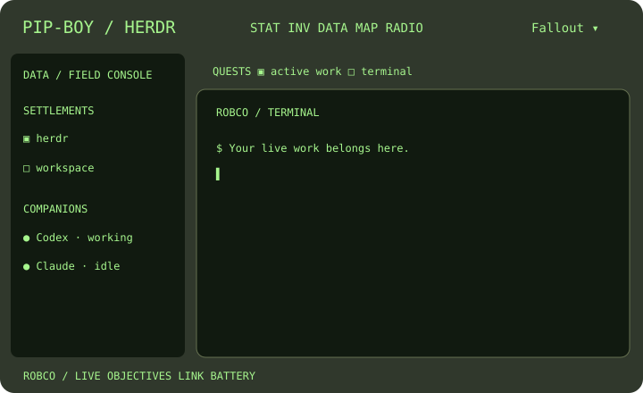

# Fallout — Pip-Boy field console for Herdr

Installed layout: `fallout`. An independent Fallout-inspired native GPUI interface with original vector art and Herdr's bundled Geist Mono font. No extracted game graphics, fonts, soundtracks, credentials, or assets. The console follows light/dark appearance. Both appearances keep a dark CRT terminal surface so agents with fixed dark backgrounds remain readable.



## Install and develop

Requires a Herdr.app build with native GPUI mods, Node.js 22 or newer, and pnpm. The runtime itself has no Node.js or package dependency. Local network/battery probes currently support macOS only. The source is this repository; installed copies should be updated through its installer.

```sh
daft clone https://github.com/avihut/herdr-fallout.git --layout contained
cd herdr-fallout/main
mise trust
mise install
mise run test
mise run check     # requires herdr-app on PATH
mise run install   # use run: mise install only installs developer tools
```

Select **Fallout** through Herdr's layout settings or an existing native layout menu. Installing does not change the active layout, appearance or shared state and does not restart anything. No dependency packages or node_modules are required.

Existing Fallout targets cause a refusal before any writes. To deliberately update them, run `mise run install-update`. The installer backs up previous Fallout files under `~/.config/herdr-app/backups/fallout/<timestamp>/` first, then writes the non-docking manifest before JavaScript and the layout after its dependencies. Other layouts, settings, key bindings and mods remain untouched. Symlinked targets are refused. Keep the backup to revert an update; restore only its Fallout-named paths while another layout is selected.

For an alternate config directory or an isolated test installation:

```sh
pnpm run install:layout --config-dir /path/to/herdr-config
pnpm run install:layout --config-dir /path/to/herdr-config --update
```

Review [RECIPE.md](RECIPE.md) for reconstruction and [the portable layout guide](docs/LAYOUT_GUIDE.md) for the design/validation workflow. Original code, documentation and SVG art are MIT licensed; see [NOTICE.md](NOTICE.md) for font and trademark notices. No live terminal screenshots are published.

## Everyday use

- **Fallout ▾**: native layout menu in the top bar. Lists every layout once, hides built-ins when personal replacements exist, marks the current layout, uses house titles including Windows 98 and Windows XP.
- **DATA**: settlements are actual workspaces, quests are actual tabs, companions are actual agents. Names and the exact statuses `working`, `blocked`, `done`, `idle` remain visible. Right-click lists for contextual actions. New settlement / quest creates a normal Herdr workspace / tab.
- **STAT**: live counts, statuses and attention objectives. Click an agent needing attention to focus it. `done` means completed unseen and changes to idle according to Herdr's rules.
- **MAP**: actual machines, connection layout state and their workspaces. A schematic, not fictional geography or physical location. Selecting a workspace travels to it.
- **INV**: two playable holotapes, discovery badges and personal bests.
- **RADIO**: a clearly labeled fictional visual station; there is no music stream. Reward chimes use Herdr's local `done` sound only when explicitly enabled; muted initially.
- **Pane ···**: splits, zoom, close, peek. Commands carry explicit pane/terminal targets. Workspace/tab close uses Herdr's normal confirmation path.
- **MANUAL / ?**: help, game launchers and hints. No keys are rebound globally.
- **PHOSPHOR**: green or amber UI text. Terminal ANSI colors retain their readable palette.
- **MOTION**: disables all decorative native loops. No animation redraw timers exist. Working status dots pulse gently; the simulated radio bars animate only while visible.

The bottom bar reads local macOS network and battery facts every 30 seconds using `/usr/sbin/scutil --nwi` and `/usr/bin/pmset -g batt`. LINK UP means an active local interface; it does **not** verify Internet reachability. A failed probe becomes LINK ?. The battery icon appears only after battery hardware is detected. It distinguishes charging, AC and battery power; a subsequent failed battery probe shows BAT ?. Tooltip text shows the exact battery result and network sampling time. Other platforms show unknown network and omit battery because no platform probe is implemented. No external telemetry requests or network probes are made by this mod.

## Playable holotapes

**01 / Password Trainer**: choose among 12 four-letter candidates. Four wrong guesses lock this training session. Likeness counts matching letters at the same position: COLD and CORD have 3/4. A selected guess cannot consume another attempt. Three paired bracket tokens are single-use: two remove a dud (never the answer), one restores four attempts. Lockout, hints and victory affect only the game. NEW SEED restarts with a new password. A win records the Hacker badge and increments the win counter.

**02 / Wasteland Courier**: original turn-based 7×7 route puzzle. Collect all three C caches and reach V with 22 fuel. @ is the courier; # is a wall. Arrow keys, WASD, direction buttons, or an adjacent tile move the courier. Invalid moves and walls consume no fuel. The shortest solution is 22 moves, verified by breadth-first search; arrival with zero fuel is a win. REWIND resets. No real resource is consumed. Wins record Pathfinder and the shortest move count.

## Discoveries (spoilers)

1. Tap the original vault iris in the header three times: Overseer maintenance record.
2. Click the service robot under STAT: Good Neighbor greeting.
3. Inspect the bottle cap under INV: Cap Collector record.
4. Tune 101.1 under RADIO: Lone Wanderer maintenance transmission.
5. Solve Password Trainer: Hacker certificate.
6. Finish Wasteland Courier: Pathfinder badge.

All are safe local lore cards or badges. No secret executes terminal input, modifies workspaces, hides real agent reports or sends anything. Collected badges, game records, palette, motion and sound preferences live in namespaced `fallout.*` shared state. Fresh game boards reset when their dialog is reopened.

## Research and design decisions

- Bethesda's [Fallout 3 PC manual](https://cdn.akamai.steamstatic.com/steam/apps/22300/manuals/fallout3_us_pc_manual.pdf), printed pp. 12–13 and 35: the Data section combines maps, quests, notes and radio; active quests and objectives are distinguished visually; hacking uses positional matches, limited guesses and paired-bracket bonuses. These informed workspace navigation, attention objectives and the trainer's mechanics. This layout never pretends its training lockout protects a real terminal.
- The [Pip-Boy Operational Instructions transcript](https://fallout.fandom.com/wiki/Pip-Boy_Operational_Instructions), original Bethesda booklet: STAT, INV, DATA, MAP and RADIO informed the five physical-looking section controls. Their Herdr mapping is a design interpretation, not a claim about Fallout lore. In particular, agents retain real names rather than being renamed after characters.
- Bethesda's [Nuka Tapper holotape description](https://gear.bethesda.net/products/fallout-nuka-tapper-holotape-replica-satin-nickel-bethesda-gear-exclusive) confirms holotapes as game-bearing media usable in terminals or a Pip-Boy. This motivates the inventory drawer and ejectable games; Courier is an original game, not a replica of a licensed title.
- [Prima's Fallout 4 Pip-Boy guide](https://primagames.com/eguides/fallout-4-eguide/stat/status/the-pip-boy-a-robco-industries-technological-wonder) describes DATA's Quests and Workshops. Settlements fit workspaces better than assigning fake numbered vaults; companions fit collaborators. Neither metaphor changes Herdr's underlying model.
- Existing Win98 and XP mods were read for native overlay/role structure and familiar discoverability. Their assets and gameplay code were not copied. XP's decorative network text was explicitly not reused.

## Files and checks

`main.js` contains top/sidebar/tabs/pane/footer/menu/help/dossier roles. `games.js` draws both games; `game.js` holds pure rules; `telemetry.js` parses local host probes; `kit.js` draws shared native controls. `assets/` contains three original monochrome SVGs. Root layout look stays in `layouts/fallout.json`; two themes are `themes/fallout-dark.json` and `themes/fallout-light.json`; settings preview is `layouts/fallout.svg`.

Run `mise run test` for pure game and installer tests, and `mise run check` for all ten native roles. See [RECIPE.md](RECIPE.md) for architecture and acceptance checks. Live validation exercised both appearances, native switching, both game victories, agent navigation, a hidden record, palette and reduced motion. Live screenshots remain private because they contain terminal conversations. Unsupported host platforms and unobserved hardware states are documented above.

Publication validation: 16 automated tests cover game outcomes, telemetry parsing and isolated installation/update/rollback. All ten roles pass the native checker. The source package also adds an overlapping-probe guard and stricter unknown telemetry parsing; these were checked and fixture-tested after live visual QA, without reinstalling or switching the active window during packaging.
