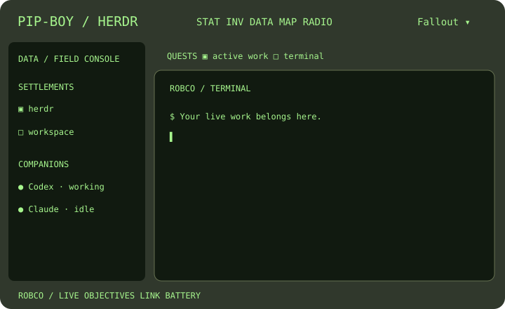

# Fallout

A native Pip-Boy field console surrounds the actual Herdr terminals with an olive instrument bezel, phosphor controls and a settlement/companion field ledger. Two ejectable holotape games and hidden maintenance records reward exploration. Green or amber chrome follows a readable light/dark shell.

## What you see

A 68px top instrument bar has the original vault iris, PIP-BOY / HERDR wordmark, STAT / INV / DATA / MAP / RADIO buttons, help and the native Fallout layout menu. macOS traffic lights have reserved space. A 280px left console (resizable 240–420px) holds the chosen field screen, scrolling independently, with motion and phosphor controls at its foot. The work area has a 42px quest strip and native tab terminals with 18px pane headers, 10px padding and an 8px split gap. The 30px bottom bar holds live attention counts, local network/battery readings and the manual. No overlay covers the terminals except a deliberately opened game, menu or record.

Dark colors: terminal #11190f, phosphor #a6f58d, metal #30382c, border #657050. Light: terminal #11190f (dark CRT retained for running agent contrast), phosphor #24552a, metal #cbd0b7, border #7c8767. Amber changes chrome text to #ffcd70 / #71420b. Geist Mono provides consistent UI and terminal typography.

## How it behaves

DATA lists actual spaces, tabs and agents. Status words remain exact: working pulses, blocked gets a warm dot, done remains distinct in counts and objectives, idle stays quiet. STAT attention entries focus their real agent. MAP groups actual spaces by machines and reports real ready/loading/unavailable layout states. INV opens native dialogs for the positional-word hacking trainer and original turn-based courier puzzle. RADIO is an explicitly simulated visual signal, silent by default. Native animation loops stop through the reduced-motion toggle; no animation timer wakes JavaScript.

Right-click settlement/tab/agent rows for targeted actions. Pane controls use the clicked pane. Fallout ▾ lists layouts with house replacement and title rules; selecting one switches using `layout.switch`. Games support wins, losses and restart, and leave work untouched. Courier additionally supports arrow keys and WASD only while its dialog has focus. Header iris, STAT robot, INV cap and RADIO frequency reveal harmless lore records; game victories earn two more badges. Help explains all controls and hints.

## Built from

Root column: top bar; row of sidebar and work column (quest strip / native active tab); footer. All font, theme, preview, titlebar and terminal keys live on that outer root. No root wrapper. Mod `fallout` dispatches ten roles through props: top, sidebar, tabs, pane, footer, menu, help, hack, salvage, dossier. It uses live `spaces`, `agents`, `panes`, `machines`, `focused`, `theme`, `settings`, `layouts`, `window`, `setAgentOrder`; `shared`/`setShared` for namespaced preferences and scores; `run`, `openOverlay`, `closeOverlay` for interaction. Pure `telemetry.js` parses the host results and an in-flight guard prevents overlapping probes. The footer alone uses `exec` for two read-only local macOS commands every 30 seconds. Optional reward sound calls `playSound("done")`. No external fetch, filesystem read, terminal typing or background shell is part of the mod.

Art consists of three newly drawn SVGs: vault iris, service robot and relay. No Fallout assets are extracted. Research links and precise game rules are in README.md.

## Watch out

Write mod.json with place:none before main.js. Keep terminal/content children native and preserve original terminal keyboard handling. Temporary check mode has no window, so optional-chain window data. Check every role: a passing default role does not check games or lists. Use a popup with width but no fixed height for the native layout menu so it anchors naturally to its trigger. Never infer Internet reachability from an active interface or invent network speed. Hide battery on desktops; retain unknown after a failed read when battery hardware was previously detected. Do not treat simulated radio or holotape resources as live system measurements. Light and dark palettes need separate visual inspection. No shared layout-picker changes are required.

The courier has a deliberately tight 22-move optimum. Its path test ensures it is winnable with the fuel budget; reaching the exit on the final fuel unit must win before the out-of-fuel check. The hacking trainer must never remove the secret as a dud or charge attempts for repeated guesses. Bracket effects are single-use per board and cannot unlock a lost session.

## Done when

- All ten mod roles pass `herdr-app check`; live `herdr-app status` has no Fallout errors.
- Both appearances show readable terminal text and a native, legible switcher/menu.
- Clicking the switcher opens at its trigger, marks Fallout, shows Windows 98/XP house titles, hides replaced built-ins, and changes layout.
- A real agent row and workspace/quest selection navigate to the correct targets.
- Hacking guesses, likeness, bracket effects, lockout, win and restart work; courier movement, fuel, caches, win/loss and rewind work.
- A maintenance record opens, badges appear in INV, help is accessible, and reduced motion removes native loops.
- Network/battery values match read-only local results, with explicit unknown states on failure and no battery badge on a computer without battery hardware.
- Restore the original layout and appearance after coordinated live validation.
